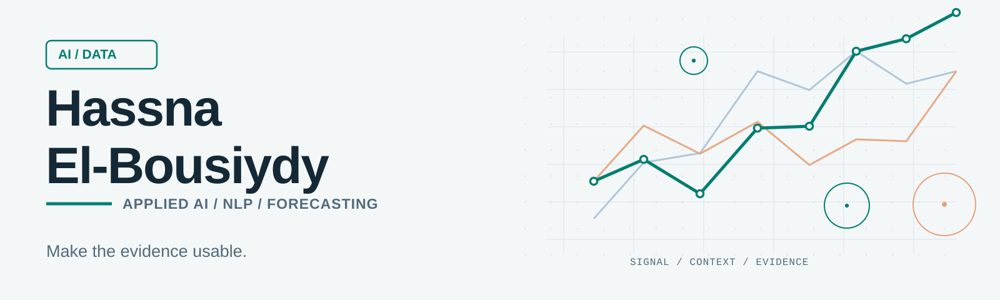

<picture>
  <source media="(prefers-color-scheme: dark)" srcset="./assets/header-dark.svg">
  <source media="(prefers-color-scheme: light)" srcset="./assets/header-light.svg">
  
</picture>

  <strong>Applied AI & Data Science · NLP & Information Retrieval · Time-Series Forecasting</strong> 
  I build AI systems that can show their work.  
  <a href="mailto:h.elbousiydy@gmail.com"><strong>Discuss a project</strong></a>
  &nbsp; · &nbsp;
  <a href="https://www.linkedin.com/in/hassna-el-bousiydy-228a91142">LinkedIn</a>
  &nbsp; · &nbsp;
  <a href="https://doi.org/10.1021/acs.chemmater.2c01356">Published research</a>

---

### What I do

I turn difficult, often unstructured data into tools people can actually use: searchable knowledge, evaluated AI assistants, structured information, and forecasting workflows.

My background combines **research in NLP and machine learning** with hands-on **Python data and AI engineering**. I care as much about whether a system is reliable and reproducible as whether the model works on a demo.

**Problems I work on:** document intelligence and information extraction · RAG and semantic search · model evaluation · time-series forecasting · data pipelines and analytics.

### Selected work

<table>
<tr>
<td width="60%" valign="top">
  <h3>01 / Make thousands of events searchable</h3>
  
<strong>Puls-Events RAG</strong> turns public event data into a French-language discovery assistant with semantic retrieval, city/date filters, deduplication, and source-grounded answers.

  
<strong>12,763</strong> unique events · <strong>14,547</strong> indexed chunks · <strong>74</strong> passing automated tests

  
Python · LangChain · Mistral · FAISS · Streamlit · Docker

  <a href="https://github.com/Hassna-elbousiydy/Puls_Events_RAG"><strong>View the case study →</strong></a>
</td>
<td valign="middle">
  
</td>
</tr>
<tr>
<td width="60%" valign="top">
  <h3>02 / Answers with evidence, not just fluency</h3>
  
<strong>Scientific Semantic Search</strong> extracts text from PDFs, retrieves candidate passages, reranks them, and generates responses with supporting sources and page references. It includes refusal for unrelated questions and separate retrieval/generation evaluation.

  
<strong>25</strong> evaluation questions · <strong>5</strong> papers in the demonstration corpus · documented error analysis

  
Sentence Transformers · FAISS · Cross-Encoder · FLAN-T5 · PyMuPDF

  <a href="https://github.com/Hassna-elbousiydy/Semantic-search-chatbot"><strong>Explore the pipeline →</strong></a>
</td>
<td valign="middle">
  
<strong>Retrieve</strong> relevant passages ↓ <strong>Rerank</strong> by question relevance ↓ <strong>Generate</strong> using evidence ↓ <strong>Attribute</strong> source and page

</td>
</tr>
<tr>
<td width="60%" valign="top">
  <h3>03 / From a paper to a reproducible model</h3>
  
<strong>Literature-to-Simulation Bridge</strong> extracts scientific parameter tables, preserves provenance, maps values to a simulator, and validates a controlled reference run.

  
<strong>2</strong> evaluated tables from <strong>1</strong> paper · <strong>7</strong> generated simulator overrides · successful controlled reproduction

  
Python · PDF extraction · PyBaMM · numerical validation

  <a href="https://github.com/Hassna-elbousiydy/literature-to-simulation-bridge"><strong>See the reproducible workflow →</strong></a>
</td>
<td valign="middle">
  
</td>
</tr>
</table>

These are documented research and proof-of-concept results under specific evaluation conditions, not claims of production-wide accuracy.

### Research foundations

Before building retrieval assistants, I worked on a more fundamental question: **how do we turn information buried in technical text into reliable structured data?**

- **LIBAC**, a co-authored, peer-reviewed annotated corpus: **6,985 paragraphs**, **28 entity types**, and reported NER **F1 scores of 81% to 83%** for the models studied. [Read the paper in *Chemistry of Materials*](https://doi.org/10.1021/acs.chemmater.2c01356).
- **Deep-learning forecasting research at Centrale Nantes**: benchmarking neural approaches for long-horizon time-series prediction, with attention to accuracy, computational cost, and reproducibility.
- **Scientific text mining**: [*What Can Text Mining Tell Us About Lithium-Ion Battery Researchers' Habits?*](https://doi.org/10.1002/batt.202000288), *Batteries & Supercaps* (2021).

### My toolkit

| Area | Tools and approaches |
|:--|:--|
| **AI & NLP** | BERT, SciBERT, spaCy, Hugging Face, Sentence Transformers, LangChain, RAG, semantic retrieval, reranking |
| **ML & forecasting** | Python, PyTorch, TensorFlow/Keras, scikit-learn, statistical modelling, time-series analysis |
| **Data & delivery** | pandas, NumPy, SQL, FAISS, Docker, Streamlit, Git, pytest, reproducible pipelines |

### How I approach a project

**Understand the decision** → **inspect the data** → **build an explicit baseline** → **evaluate failure cases** → **deliver something maintainable**.

I work in **English and French** and am open to **freelance AI/data projects, consulting discussions, and research-to-product collaborations**.

  <strong>Have a document-heavy workflow, an information retrieval problem, or a forecasting challenge?</strong>  
  <a href="mailto:h.elbousiydy@gmail.com"><strong>Let's talk about the problem →</strong></a>

